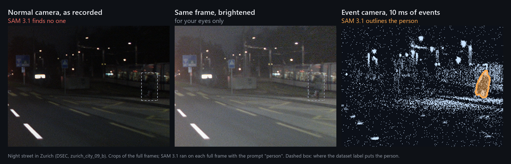
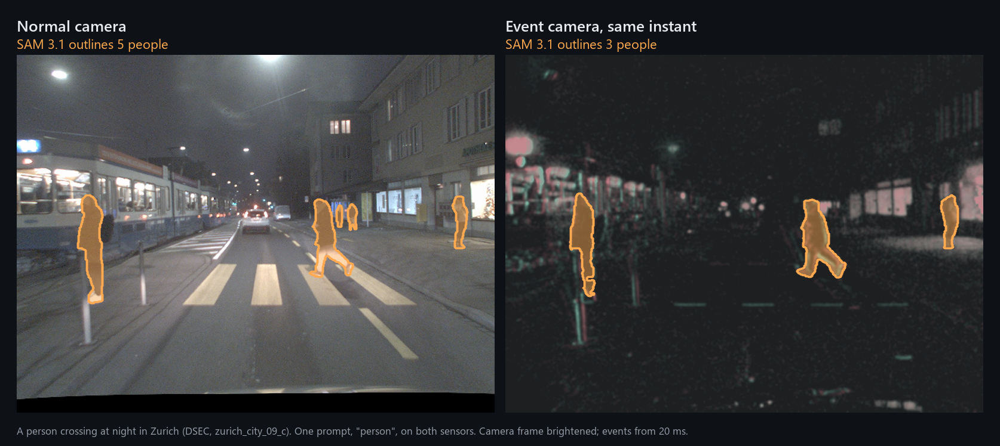
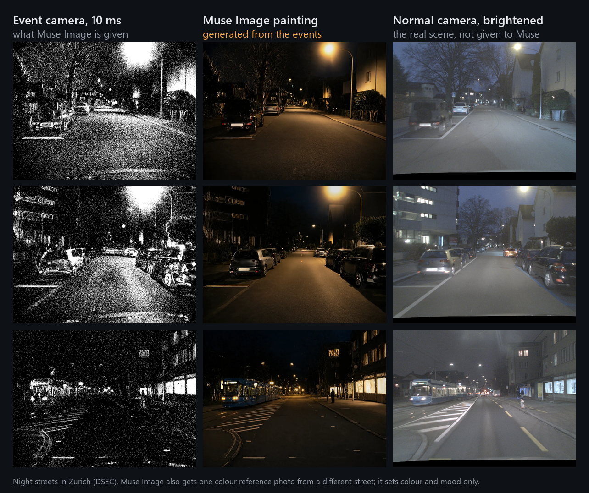
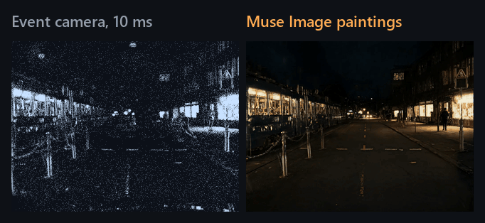
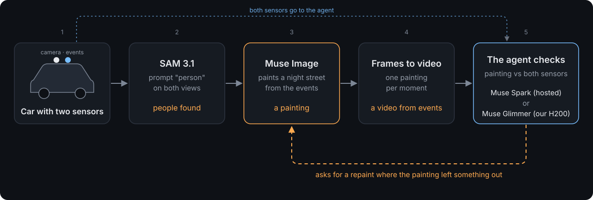
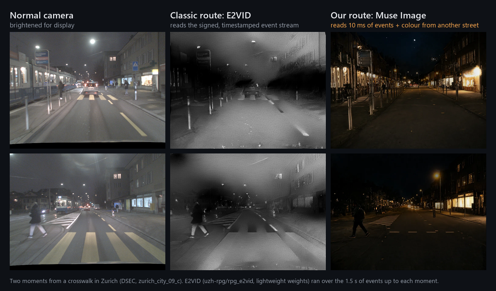

# Afterdark

**A night camera’s flickers become a visible street—and an agent catches the tram the painting missed.**

Afterdark brings Meta’s general vision and image models to a brain-inspired event camera, with no event-specific retraining. On recorded night drives through Zurich, SAM 3.1 outlines people in both ordinary camera frames and rendered events. Muse Image paints the events into readable streets. An inspection agent checks those paintings against the sensors—and asks for a targeted repaint when something is missing.

It is a way to explore what a night sensor recorded, what a model can see, and what a generated picture invented.

**[Open the live demo](https://yazan-o.github.io/afterdark/)** · [Try it locally](#try-it-locally) · [The missing tram](#the-missing-tram) · [How the pipeline works](#how-the-pipeline-works) · [Technical reference](#technical-reference)



*A tram stop in Zurich at night. Left: the recorded camera frame. Middle: the same frame brightened. SAM 3.1 finds no person in either. Right: 10 ms of events at the same instant; with the same prompt, “person”, SAM outlines them. The dashed box marks the dataset’s label.*

## A different way to see after dark

An ordinary camera collects light over an exposure. At night, too little light hides detail; longer exposures blur movement. A person beside the road can disappear into the background.

An **event camera** records changes instead of whole pictures. Each pixel works independently, reporting when brightness changes, where it happened, and whether it became brighter or darker—with microsecond timestamps. This retina-inspired design handles a wide range of brightness and avoids the conventional frame-exposure source of motion blur, though its response also slows in very dark conditions.

The difficulty is reading its output: a cloud of flickers, not a photograph. Event-vision systems often need specialist reconstruction networks or detectors trained for event data.

Afterdark asks a practical **Push the Frontier** question: can Meta’s general models make this unfamiliar sensor useful without first building another trained perception stack?

## One prompt, two sensors

Afterdark gives **SAM 3.1** an ordinary camera frame, remapped into the event camera’s view, and an image accumulated from 10–50 ms of events. Both receive the same prompt: **“person”**.

The model outlines people on both kinds of input without event-specific training. The opening image shows the most compelling case: a person found in the event view when neither the original nor brightened camera frame produced a detection.



*Two sensor representations, one pretrained segmentation model.*

That is a demonstrated complementary view, not a claim that events always win. In a 37-person night probe, SAM found 30 people on brightened camera frames and 18 on 10 ms event frames. The useful finding is that the event view can reveal someone the camera-side model misses.

## From flickers to a street you can read

**Muse Image** receives an event rendering and a colour reference from another street. **The initial painting request contains no ordinary-camera image of the scene.**

The result makes sparse motion and edge activity legible as a night street. In the recorded examples, parked cars, lane markings, lamps and houses occupy positions supported by the events. Colour, texture and regions without event evidence are generated—not recovered facts.



*Events supply scene structure; a different-scene reference supplies style. The camera is shown for comparison, not supplied for initial generation.*

Afterdark paints ten keyframes per second of driving and plays them with soft crossfades. This produces a watchable interpretation of the event stream, not ground-truth video or output from a native video model.



*Recorded events become a generated moving view. Playback is prepared in advance, not computed in real time.*

## The missing tram

A convincing picture can still leave out something important.

In the recorded crosswalk inspection, the ordinary camera shows a tram. **Seven nearby original paintings omit it.** This is where Afterdark moves beyond generating a pleasing image.

The inspection workflow connects six tools: `scan`, `look`, `find`, `compare`, `repaint` and `report`.

1. **Inspect the evidence.** Muse Spark chooses checks and examines the recorded views and painting.
2. **Measure the mismatch.** SAM outlines objects; deterministic matching code compares their boxes and identifies camera objects missing from the painting.
3. **Act on it.** Spark requests a targeted Muse Image repaint, using the real camera’s box to guide the repair.

**The recorded repaint restores a tram.** The agent does not merely describe an error; it changes the generated view in response to sensor evidence.

This repair is deliberately **camera-guided**. Initial generation uses events and an unrelated style reference; inspection and correction can consult the matching camera scene. The repaired image remains generated, but its correction has an explicit source.



*Generation and verification have different jobs: make the events readable, then check the result against recorded reality.*

## Four Meta models, distinct jobs

| Model | Role in Afterdark |
| --- | --- |
| **SAM 3.1** · `sam-3.1` | Segments prompted objects in camera frames, rendered events and paintings; supplies masks and boxes for comparison. |
| **Muse Image** · `muse-image-1.0` | Paints event frames using a different-scene style reference and performs targeted, camera-guided repairs. |
| **Muse Spark 1.3** · `muse-spark-1.3` | Chooses inspection tools and checks through the Meta Model API, including the recorded missing-tram repair. |
| **Muse Glimmer 30B** | Runs as an open-weights agent on an NVIDIA H200 through llama.cpp, following a code-computed tool plan and writing notes rather than independently replanning. |

Glimmer inference runs locally; its SAM checks and Muse Image repaints still use hosted services. Numeric findings come from tool results and matching code, not an agent’s prose.

## How the pipeline works

One recorded drive goes in; a playable, inspectable night street comes out. Every stage is a small module you can run on its own.

| Stage | What happens | Code |
| --- | --- | --- |
| 1. Read the sensors | DSEC `events.h5` is sliced into 10 ms event frames every 100 ms, plus activity maps and packed event points for playback. The left colour camera is remapped into the event camera's view with DSEC's calibration. | [export_moment.py](pipeline/export_moment.py), [dsec_util.py](pipeline/dsec_util.py) |
| 2. Find people on both sensors | **SAM 3.1** gets the camera frame and the event frame with the same text prompt. Its streamed masks and boxes are decoded and saved for every frame. | [meta.py](afterdark/meta.py), [sam_common.py](pipeline/sam_common.py), [people.py](pipeline/people.py) |
| 3. Paint the events | **Muse Image** gets each event frame and a style reference from another street, never the scene's camera frame. Retries handle transient errors and stop on content-filter refusals. | [paint_moment.py](pipeline/paint_moment.py) |
| 4. Turn paintings into video | Keyframes are aligned and blended with soft crossfades, then packed for the browser. | [stabilise.py](pipeline/stabilise.py), [drift.py](pipeline/drift.py), [pack_web.py](pipeline/pack_web.py) |
| 5. Inspect and repair | The agent (**Muse Spark 1.3** hosted, or **Muse Glimmer 30B** on our own H200) calls six tools: `scan`, `look`, `find`, `compare`, `repaint`, `report`. **SAM 3.1** supplies objects, plain arithmetic decides what the painting lacks, and **Muse Image** repaints only that patch. | [agent.py](afterdark/agent.py), [verdict.py](afterdark/verdict.py) |
| 6. Audit the whole drive | Every frame's camera objects are matched against the painting, so the page can show what was left out and where. | [audit.py](pipeline/audit.py), [pack_audit.py](pipeline/pack_audit.py) |
| 7. Serve and play | A small server holds the key and caps paid calls; a spend ledger records every call; the WebGL page plays sensors, paintings and masks side by side with no network calls. | [server.py](afterdark/server.py), [spend.py](afterdark/spend.py), [web/](web/) |

104 automated tests cover the request formats, mask decoding, matching arithmetic, audit packing and server limits ([tests/](tests/)).

## Built around evidence

Afterdark connects event export, calibration remapping, model requests, segmentation, object matching, repainting and browser playback. Sensor views and generated views stay distinguishable throughout.

The inputs are recorded left-camera streams from [DSEC](https://dsec.ifi.uzh.ch/), the stereo driving dataset by Gehrig and colleagues. Remapping aligns camera orientation and intrinsics without depth-based parallax correction. A SAM call takes about 1.2 seconds from a laptop; the viewer therefore presents prepared playback rather than a real-time perception system.

For night-perception teams, the opportunity is a complementary sensor readable by a shared model. For event-vision researchers, it is a route to inspecting data without first training a reconstruction network. For reviewers of night drives, it makes both the sensor evidence and the painting’s omissions visible.

## Try it locally

With **Python 3.10 or newer**, run from the repository directory:

```sh
python -m pip install -e .
python -m afterdark serve
```

Open **http://127.0.0.1:8080**.

Recorded playback uses bundled local assets and **needs no API key**. Fresh segmentation, painting and agent tool calls require credentials and network services. See [Technical reference](#technical-reference) for environment settings, rebuilding instructions, model traces, measurements and complete licences.

## Built during the hackathon

**Mohamad Yazan Sadoun built Afterdark as a solo entry.** New work includes event export and calibration mapping; painting prompts and retries; masks and face blur; playback preparation; model clients; inspection tools and deterministic object matching; the spend ledger; and the server, viewer and film tooling.

The implementation lives in [`pipeline/`](pipeline/), [`afterdark/`](afterdark/), [`web/`](web/) and [`film/`](film/).

DSEC recordings, pretrained models and third-party libraries predate the entry. Original Afterdark code is MIT-licensed. DSEC-derived assets are distributed under **CC BY-SA 4.0**, separately from the code; full attribution and dependency terms follow in the technical reference.

## Technical reference

<details>
<summary>Recorded measurements</summary>

## What we measured

All numbers below come from the run folders of this build, on recorded DSEC night drives.

| Question | Result |
| --- | --- |
| Labelled night pedestrians that SAM 3.1 outlined on both the camera and the event view (box overlap 0.5 or more) | 21 of 96 |
| Night people SAM 3.1 found on the brightened camera, and on 10 ms event frames, in a 37-person probe | 30 and 18 of 37; the top figure is one found only on events |
| Cars Muse Image placed where the camera saw them, one 6 s street moment | 274 of 352, against 135 for paintings of a different frame |
| People the painting left out, before and after camera-guided repair by the agent | 216 and 12, of 334 camera sightings |
| Time for one SAM 3.1 call from a laptop | about 1.2 s, so the clip runs frame by frame, not in real time |

</details>

<details>
<summary>Data, research and the classic reconstruction comparison</summary>

## The data

[DSEC](https://dsec.ifi.uzh.ch/) ([Gehrig et al., 2021](https://arxiv.org/abs/2103.06011)): a car driving through Zurich and around Switzerland, day and night, with a stereo pair of Prophesee Gen3.1 event cameras (640 x 480) and a stereo pair of FLIR Blackfly S colour cameras (1440 x 1080, 20 frames per second), about 4.5 cm apart across the two kinds ([paper](https://arxiv.org/pdf/2103.06011), p. 3). Every camera frame and event in Afterdark is recorded data; the paintings are generated, and playback samples the events. People in its labelled detection set ([Gehrig and Scaramuzza, Nature 2024](https://www.nature.com/articles/s41586-024-07409-w)) guided where we looked.

## The usual way is a whole research pipeline

Event-vision research has built special tools for this, often chained together:

1. **Simulators** turn ordinary videos into fake events, because real labelled event data is scarce: ESIM ([Rebecq et al., 2018](https://rpg.ifi.uzh.ch/docs/CORL18_Rebecq.pdf)) and v2e ([Hu et al., 2021](https://arxiv.org/abs/2006.07722)).
2. **Reconstruction networks**, trained on that simulated data, turn events back into grey images: E2VID ([Rebecq et al., 2019](https://arxiv.org/abs/1906.07165)).
3. **Detectors trained on events** find cars and people, usually trained per dataset and per task.

Each is its own model, often its own training run and its own expertise. Direct event-based methods also exist, and they too are trained for the event data they run on.

## The research behind it

Afterdark grew out of a PhD on event-based vision. During the hackathon we also ran a research track on finding pedestrians from events alone, on the Prophesee Gen1 driving benchmark ([de Tournemire et al., 2020](https://arxiv.org/abs/2001.08499)). We scored the strongest released event-camera detectors with one evaluation script on the official test split; an independent re-run reproduced every score within 0.01 AP. The best, Ev-DTAD-B, reached 39.6 pedestrian AP. Those detectors were trained for that dataset. Afterdark asks how far Meta's general models get with no event training at all.



*E2VID reads 1.5 s of signed, timestamped events up to each moment, through a network trained on simulated data. Muse Image reads one 10 ms event frame and a colour reference from another street. They take different inputs, so this is a side-by-side look, not a contest.*

</details>

<details>
<summary>Environment settings and live model calls</summary>

## Environment settings

From this directory:

```sh
python -m pip install -e .
python -m afterdark serve
```

Open `http://127.0.0.1:8080`. Recorded playback uses local assets and needs no key. Fresh SAM 3.1 and Muse Image calls need `MODEL_API_KEY`, `AFTERDARK_SOURCE` and `AFTERDARK_STYLE`; see [server.py](afterdark/server.py). Keep credentials outside the repository.

</details>

<details>
<summary>Run your own drive</summary>

## Running your own drive

The DSEC exporter accepts:

```text
<DSEC_ROOT>/<sequence>/
  ev/events.h5
  ev/rectify_map.h5
  img/*.png
  image_timestamps.txt
```

Install batch dependencies in your processing environment:

```sh
python -m pip install -e .
python -m pip install opencv-python h5py hdf5plugin PyYAML
```

The selection below comes from [moments.sh](pipeline/moments.sh). From this directory in Bash or Git Bash, download the left-camera inputs listed on the [official DSEC download page](https://dsec.ifi.uzh.ch/dsec-datasets/download/). The event archive contains `events.h5` and `rectify_map.h5` at its root; the image archive contains numbered PNGs at its root. The commands extract them into the layout above.

```sh
mkdir -p work/downloads work/dsec/zurich_city_09_c/ev work/dsec/zurich_city_09_c/img work/moments
curl -fL --retry 3 -o work/downloads/events_left.zip https://download.ifi.uzh.ch/rpg/DSEC/train/zurich_city_09_c/zurich_city_09_c_events_left.zip
curl -fL --retry 3 -o work/downloads/images_rectified_left.zip https://download.ifi.uzh.ch/rpg/DSEC/train/zurich_city_09_c/zurich_city_09_c_images_rectified_left.zip
curl -fL --retry 3 -o work/dsec/zurich_city_09_c/image_timestamps.txt https://download.ifi.uzh.ch/rpg/DSEC/train/zurich_city_09_c/zurich_city_09_c_image_timestamps.txt
python -m zipfile -e work/downloads/events_left.zip work/dsec/zurich_city_09_c/ev
python -m zipfile -e work/downloads/images_rectified_left.zip work/dsec/zurich_city_09_c/img
python pipeline/export_moment.py --root work/dsec --seq zurich_city_09_c --t0 58305557568 --seconds 9 --out work/moments/crosswalk
```

The historical style file's public origin was not preserved in the run evidence. For a reproducible alternative, use the camera panel from frame 0 of DSEC's [Zurich city 10b preview](https://dsec.ifi.uzh.ch/wp-content/uploads/2021/05/zurich_city_10_b.gif), a different sequence from the crosswalk. The 576x144 preview has three panels; crop the rightmost 192x144 camera panel. This alternative changes the style input and will not recreate the recorded paintings. It carries the DSEC credit and licence below.

```sh
curl -fL --retry 3 -o work/style-source.gif https://dsec.ifi.uzh.ch/wp-content/uploads/2021/05/zurich_city_10_b.gif
python -c "import hashlib; from pathlib import Path; p=Path('work/style-source.gif'); assert hashlib.sha256(p.read_bytes()).hexdigest() == 'df69cc781a7a5ce638b015cebfeec49ee79a4a06967a74577c17222a9339760a'"
python -c "from PIL import Image; im=Image.open('work/style-source.gif'); im.seek(0); assert im.size == (576,144); im.convert('RGB').crop((384,0,576,144)).save('work/style.png')"
```

Set `MODEL_API_KEY` in your process environment before the following paid preparation steps. These commands generate new assets and package them into `web/moments/crosswalk`; preserve the recorded assets separately if needed.

```sh
python pipeline/paint_moment.py work/moments/crosswalk --style work/style.png --workers 1 --out paint --step 1
python pipeline/people.py work/moments/crosswalk
python pipeline/blur_faces.py work/moments/crosswalk
python pipeline/stabilise.py work/moments/crosswalk
python pipeline/pack_web.py work/moments/crosswalk
```

The exporter fetches DSEC calibration. Remapping uses rotation and intrinsics without depth-based parallax correction. Review generated content, camera blur and object alignment before packaging. [pack_web.py](pipeline/pack_web.py) packages processed frames into the viewer layout.

</details>

<details>
<summary>Run the open-weights Muse Glimmer route</summary>

## Muse Glimmer on our lab machine

Muse Glimmer 30B ran on our lab machine's NVIDIA H200 through llama.cpp at commit `bee23322f1baa3d2dd16b8339bed6aff4a8eb663`. The [sanitized launch record](evidence/glimmer/setup.txt), [GPU and weight evidence](evidence/glimmer/setup.txt) and [trace](evidence/glimmer/trace_glimmer_crosswalk.json) identify the setup. The [probe](evidence/glimmer/probe.json) records about 30 generated tokens per second.

Across 5 runs, 66 of 66 tool calls parsed cleanly. The raw calls are in [raw_crosswalk_run1.jsonl](evidence/glimmer/raw_crosswalk_run1.jsonl), [raw_crosswalk_run2.jsonl](evidence/glimmer/raw_crosswalk_run2.jsonl), [raw_crosswalk_run3.jsonl](evidence/glimmer/raw_crosswalk_run3.jsonl), [raw_street_run1.jsonl](evidence/glimmer/raw_street_run1.jsonl) and [raw_street_run2.jsonl](evidence/glimmer/raw_street_run2.jsonl). This counts valid tool arguments. It does not score findings.

The recorded trace is `trace_glimmer_crosswalk.json`, shipped at [web/moments/crosswalk/agent.glimmer.json](web/moments/crosswalk/agent.glimmer.json). Glimmer follows the code's step plan. It writes the notes and the report. Keep its report text off screen. It contains a wrong sentence about unmatched cars. The tool results preserve the counts.

The [weight evidence](evidence/glimmer/setup.txt) records these SHA256 hashes for the Q4_K_M files:

```text
Muse-Glimmer-30B-KQuant-17GB-Q4_K_M.gguf
4cc57c0f51040a226e5a72cc47b7613f7772950e460a665f7083de89f183f60e
mmproj-Muse-Glimmer-30B-Q4_K_M.gguf
f48b452316f9b213758e8659444029b961a24a07f99a1abb2a9f88b06f7c00c6
```

The weights come from [Meta's Muse Glimmer GGUF repository](https://huggingface.co/meta-models/Muse-Glimmer-30B-GGUF), as recorded in the [sanitized setup](evidence/glimmer/setup.txt). The following direct-server equivalent uses the recorded commit, build settings and server arguments. Run it on a Linux NVIDIA H200 machine with CUDA 12.8, a C++ compiler, Git, CMake, Ninja and curl installed. Other GPU architectures require a different `CMAKE_CUDA_ARCHITECTURES` value. These commands replace the private lab launcher and its shared-machine guards and SSH tunnel.

```sh
mkdir -p "$HOME/afterdark-glimmer"
cd "$HOME/afterdark-glimmer"
git clone https://github.com/ggml-org/llama.cpp.git
git -C llama.cpp checkout bee23322f1baa3d2dd16b8339bed6aff4a8eb663
cmake -S llama.cpp -B llama.cpp/build -G Ninja -DGGML_CUDA=ON -DCMAKE_CUDA_ARCHITECTURES=90 -DCMAKE_BUILD_TYPE=Release -DLLAMA_CURL=OFF -DCMAKE_CUDA_COMPILER=/usr/local/cuda-12.8/bin/nvcc
cmake --build llama.cpp/build -j 24 --target llama-server
curl -fL --retry 3 -o Muse-Glimmer-30B-KQuant-17GB-Q4_K_M.gguf https://huggingface.co/meta-models/Muse-Glimmer-30B-GGUF/resolve/main/Muse-Glimmer-30B-KQuant-17GB-Q4_K_M.gguf
curl -fL --retry 3 -o mmproj-Muse-Glimmer-30B-Q4_K_M.gguf https://huggingface.co/meta-models/Muse-Glimmer-30B-GGUF/resolve/main/mmproj-Muse-Glimmer-30B-Q4_K_M.gguf
printf '%s\n' '4cc57c0f51040a226e5a72cc47b7613f7772950e460a665f7083de89f183f60e  Muse-Glimmer-30B-KQuant-17GB-Q4_K_M.gguf' 'f48b452316f9b213758e8659444029b961a24a07f99a1abb2a9f88b06f7c00c6  mmproj-Muse-Glimmer-30B-Q4_K_M.gguf' | sha256sum -c -
export OMP_NUM_THREADS=1
export LD_LIBRARY_PATH="/usr/local/cuda-12.8/lib64:$PWD/llama.cpp/build/bin${LD_LIBRARY_PATH:+:$LD_LIBRARY_PATH}"
llama.cpp/build/bin/llama-server -m Muse-Glimmer-30B-KQuant-17GB-Q4_K_M.gguf --mmproj mmproj-Muse-Glimmer-30B-Q4_K_M.gguf -ngl 99 -c 32768 -np 1 --jinja --temp 1.0 --top-p 0.95 --top-k 64 --host 127.0.0.1 --port 8091 --alias Muse-Glimmer-30B
```

In another shell, from this Afterdark directory after preparing the moment below:

```sh
export GLIMMER_URL=http://127.0.0.1:8091/v1
export GLIMMER_MODEL=Muse-Glimmer-30B
export AFTERDARK_STYLE="$PWD/work/style.png"
python -m afterdark agent work/moments/crosswalk --route glimmer --held 68
```

Glimmer inference is local; the agent's SAM checks and Muse Image repaints still require `MODEL_API_KEY` and paid services. The public sources and archive layouts were checked; a fresh model build and full paid rebuilding are **UNVERIFIED**.

</details>

<details>
<summary>Model code and API references</summary>

## Each Meta model and its job

- **SAM 3.1** (`sam-3.1`) outlines people, cars and trams on the camera frame and on event images. See [meta.py](afterdark/meta.py), [people.py](pipeline/people.py) and [sam_common.py](pipeline/sam_common.py).
- **Muse Image** (`muse-image-1.0`) paints night streets from event frames and repaints patches the agent asks for. See [paint_moment.py](pipeline/paint_moment.py) and [agent.py](afterdark/agent.py).
- **Muse Spark 1.3** (`muse-spark-1.3`) is the agent behind the inspect button. It chooses its own checks. See the [Spark trace](evidence/spark/trace_spark_crosswalk_run2.json).
- **Muse Glimmer 30B** runs as an open-weights agent on our own NVIDIA H200. It follows a step plan computed by code and writes the notes. See [below](#muse-glimmer-on-our-lab-machine).

## API sources

Every request shape in [meta.py](afterdark/meta.py) follows Meta's documentation, read live during the build.

| Endpoint, model or field | Page read |
| --- | --- |
| Meta base `https://api.meta.ai/v1`, `MODEL_API_KEY`, models `muse-spark-1.3` and `sam-3.1` | https://dev.meta.ai/docs/models |
| `POST https://api.meta.ai/v1/responses`, Bearer authorization, JSON `model` and `input` | https://dev.meta.ai/docs/api-reference/responses/create-response |
| SAM `input[].type=message`, `role=user`, `content[].type=input_text`, `text`, `type=input_image`, string `image_url`; base64 data URLs; `stream=true` | https://dev.meta.ai/docs/sam/segmenting |
| SAM scores requested by `metadata.include_confidence="true"` (a string); default lossless mask encoding | https://dev.meta.ai/docs/sam/segmenting#confidence |
| SSE `response.output_text.delta`, `delta`, terminal `response.completed`; empty completed lane means no matches | https://dev.meta.ai/docs/sam/reading-segmentation |
| SAM frame `<0f>`, integer object id, `box` fields `x1,y1,x2,y2,w,h,c`; `mask` fields `x,y,c,data`; data header height,width; `~` lossless / `!` one_bit; base85 payload | https://dev.meta.ai/docs/sam/reading-segmentation |
| Boxes use inclusive corners; encoded masks can be decoded using the optional vendor parser | https://dev.meta.ai/docs/sam/client-libraries |
| Meta Chat Completions `model`, `messages`, `role`, `content`; result `choices[0].message.content`; HTTP rate-limit backoff | https://dev.meta.ai/docs/protocols/chat-completions |
| `POST https://api.meta.ai/v1/chat/completions`, Bearer authorization and JSON body | https://dev.meta.ai/docs/api-reference/chat-completions/create-chat-completion |
| Vision `content[].type=text`, `text`; `type=image_url`, nested `image_url.url` with MIME/base64 data URL; multiple images | https://dev.meta.ai/docs/image-understanding |
| Baseten `POST https://inference.baseten.co/v1/chat/completions`, `BASETEN_API_KEY`, Bearer authorization, `model`, `messages`, `choices[0].message`, `finish_reason` | https://docs.baseten.co/inference/model-apis/overview |
| Baseten `tools[].type=function`, nested `function.name,description,parameters`; response `message.tool_calls`, `id`, `function.name`, JSON string `function.arguments` | https://docs.baseten.co/inference/function-calling |
| Baseten vision `image_url.url`, base64 media accepted within request-body limits; Muse Spark Open vision support | https://docs.baseten.co/inference/model-apis/vision |
| Requested `meta-models/muse-spark-open-1026` | https://cerebralvalley.ai/e/meta-ai-developer-hackathon/details (supplied signed-in transcription: `hackathon/competition/participant_guide.md`) |

</details>

## Licences and credits

[DSEC](https://dsec.ifi.uzh.ch/), Gehrig et al., *DSEC: A Stereo Event Camera Dataset for Driving Scenarios*, supplies the Zurich moments in [web/moments/index.json](web/moments/index.json). DSEC is [Creative Commons Attribution-ShareAlike 4.0 International](https://creativecommons.org/licenses/by-sa/4.0/). Derived material in `web/moments` is distributed under that same licence, including event images, sampled event files, camera derivatives, paintings, masks and activity maps derived from the recordings. It is excluded from the code's MIT grant.

Afterdark's changes are interval selection, event accumulation and sampling, calibration remapping, painting generation and release processing such as resizing, blending and face blur. Sequence and timestamp metadata identify the source interval. Dataset authors do not endorse Afterdark.

Original Afterdark code is [MIT](LICENSE), Copyright (c) 2026 Mohamad Yazan Sadoun. The fonts in `web/fonts/` are IBM Plex Mono under the SIL Open Font License 1.1, with its text in [web/fonts/OFL.txt](web/fonts/OFL.txt).

### Dependencies

These are package dependencies, batch dependencies and development tools. They are installed separately; their licences do not become MIT through this project.

- HTTPX: [BSD-3-Clause](https://github.com/encode/httpx/blob/master/LICENSE.md).
- Pillow: [MIT-CMU](https://github.com/python-pillow/Pillow/blob/main/LICENSE).
- NumPy: [BSD-3-Clause](https://github.com/numpy/numpy/blob/main/LICENSE.txt), plus notices for bundled binary components.
- OpenCV: [Apache-2.0](https://github.com/opencv/opencv/blob/4.x/LICENSE). The opencv-python packaging is [MIT](https://github.com/opencv/opencv-python/blob/4.x/LICENSE.txt); wheels include [third-party notices](https://github.com/opencv/opencv-python/blob/4.x/LICENSE-3RD-PARTY.txt).
- h5py: [BSD-3-Clause](https://github.com/h5py/h5py/blob/master/LICENSE). Bundled HDF5 retains its own notices.
- hdf5plugin: [MIT](https://github.com/silx-kit/hdf5plugin/blob/main/LICENSE). Bundled HDF5 filters and compression libraries have [separate licences](https://github.com/silx-kit/hdf5plugin/blob/main/doc/information.rst#license).
- PyYAML: [MIT](https://github.com/yaml/pyyaml/blob/main/LICENSE).
- websocket-client, film browser control: [Apache-2.0](https://github.com/websocket-client/websocket-client/blob/master/LICENSE).
- Matplotlib, film audio generation: [Matplotlib licence and included component notices](https://matplotlib.org/stable/project/license.html).
- SciPy, film audio generation: [BSD-3-Clause and bundled component notices](https://github.com/scipy/scipy/blob/main/LICENSE.txt).
- Google Chrome, film rendering tool installed separately: [Chrome terms](https://www.google.com/chrome/terms/) and the component notices supplied with the installed browser.
- FFmpeg, film encoding tool installed separately: [licence depends on the build configuration](https://ffmpeg.org/legal.html). Retain the notices supplied with the selected build.
- meta_sam_parser: [SAM License](https://github.com/meta-models/meta-sam/blob/main/LICENSE), as shipped in the installed parser distribution. It is used to decode segmentation masks.
- setuptools, build tool: [MIT](https://github.com/pypa/setuptools/blob/main/LICENSE).
- pytest, test tool: [MIT](https://github.com/pytest-dev/pytest/blob/main/LICENSE).
- Python: [PSF licence and included component notices](https://docs.python.org/3/license.html).
- IBM Plex Mono, including the files in `web/fonts/`: [SIL Open Font License 1.1](https://github.com/IBM/plex/blob/master/LICENSE.txt), Copyright IBM Corp., reserved font name "Plex".

HTTPX and the other packages install their own dependencies. Retain the licence files shipped with those distributions when redistributing an environment or binary. This source list is not a wheel-bundle inventory.

### Models

Muse Image, SAM 3.1 and Muse Spark are accessed through Meta's hosted service. Muse Glimmer weights and llama.cpp retain their upstream terms. The Glimmer Q4_K_M files come from `meta-models/Muse-Glimmer-30B-GGUF`, as recorded in [sanitized setup](evidence/glimmer/setup.txt). The [weight evidence](evidence/glimmer/setup.txt) records their SHA256 hashes. Muse Spark Open has an optional client route in [meta.py](afterdark/meta.py). No model weights are included in this source tree.
